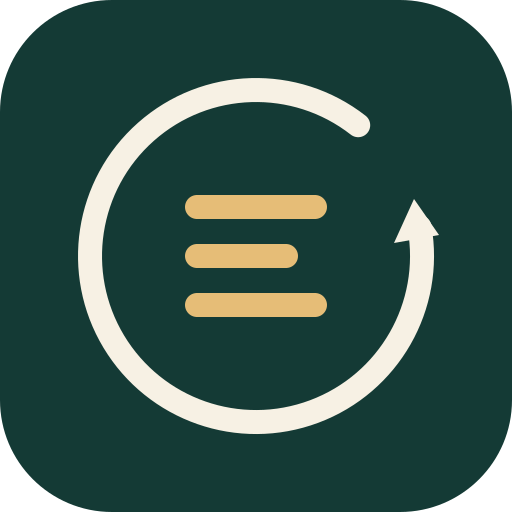

# 吾日三省吾身 · think3 Skill



**改了三遍，错得很稳定。容我三省。**

think3 是一个给 **Codex 等 AI 代理用的复盘与纠偏 Skill**。它把何时回头检查、检查到什么程度、怎样把经验落实到下一次行动，整理成一套可安装、按需使用的规则。

如果你经常把需要多轮修改、验证和交接的任务交给 AI，想让它在关键判断上多一道核对，think3 值得试用。尤其是：同一方法反复重试却没有新信息、交付结论超出了验证范围，或上次的“下次注意”一直躺在总结里。

[下载并安装](https://github.com/Serein-Zhang/think3/releases/latest) · [查看技能规则](skills/think3/SKILL.md) · [版本记录](CHANGELOG.md) · 当前版本 **1.3.2**

## 装进去的是哪些具体做法

“再想想”很容易说。think3 把后面的做法也写了进去：

- **省所托：用户要修门，吾怎么打磨起了窗？** 对象、目标或关键前提出现偏差时，先检查会影响下一步的那一点；局部核对够用，就继续工作。
- **省所言：“大功告成”四个字，可有证据撑腰？** 对齐结论和验证范围；复用旧经验前，检查对象、版本、环境是否适用，以及记录有没有被撤回或替代。
- **省所行：上次说“下次注意”，这次注意了吗？** 优先把防错检查放进实际使用的代码、构建入口或验证步骤；已有项目记录继续沿用。

这些做法都能在 [技能规则](skills/think3/SKILL.md) 中逐条查看。安装的价值在于复用一套现成的工作约定。**它能给你的模型增加多少收益，需要对照验证。** 如果现有代理和项目流程已经稳定做到这些，额外收益可能很小。

## 对照结果，摆上来看看

下面是 **2026-11-01 留存的历史合成评审**，每版各一次文本模拟；情境中的修复、构建和设备操作没有实际执行。

| 比较项目 | 旧版 | 新版 |
| --- | --- | --- |
| 16 个场景中，选用判断符合预设判据 | 1.2.2：**14/16** | 1.3.0：**16/16** |
| 其中 7 个不应介入的场景，误选次数 | 1.2.2：**0/7** | 1.3.0：**0/7** |
| 8 个经验复用场景，原评审判定合理 | 1.3.0：**8/8** | 1.3.1：**8/8** |

**多选中两次，不能记成多解决两个问题。** 旧版在那两个未选用 Skill 的场景里，也提出了核对尺寸和发送元数据的正确动作。第二组则明确打平；这些结果尚未证明任务成功率提高、耗时减少或返工变少。

当前还缺 **不装 Skill、只加一段简短复盘提示、安装 think3** 三组在相同任务上的执行对照。26 项自动测试覆盖的是跟踪工具和归档行为，也不能拿来充当效果成绩。

仓库附有 [逐例输出与汇总](validation/behavior-comparisons/summary.json)、[评测方法、反证与下一轮比较方案](docs/evaluation.md)。当前 1.3.2 的复盘规则沿用 1.3.1，表中保留实际受评版本。

## 一次纠偏，可以很短

下面是用法示意，展示期望的检查方式，不是实测记录或固定回复模板。

```text
$think3 你刚才说问题已经修好了，但目前只改了配置文件。核对一下这个结论。
```

> 这话说满了，得回头核对。目前能确认的是配置文件已更新，应用中的效果还没验证。下一步先核对应用实际加载的配置路径，再在应用中重现原问题并检查结果。在这之前，交付状态应写为“配置已更新，效果待验证”。

有修复授权时，代理继续完成范围内的检查与改进；只要求复盘时，给出判断和建议。简单问题几句话就够，需要系统复盘时再展开。

## 安装后，直接试一句

1. 从 [最新 Release](https://github.com/Serein-Zhang/think3/releases/latest) 下载 `think3-<版本号>-runtime.zip` 运行包，解压得到 `think3` 文件夹。
2. 将整个文件夹放进宿主的技能目录。Codex 未自定义目录时，放到用户目录下的 `.codex/skills/think3/`；自定义时使用 `CODEX_HOME/skills/think3/`。已有安装先备份，再替换运行文件。
3. 在宿主发现该 Skill 后，在任务对话中输入：

```text
$think3 复盘当前任务，找出最值得保留、改变或停止的做法，并给出下一步。
```

也可以直接从源码复制 [skills/think3/](skills/think3/) 整个目录，保留内部文件的相对位置。**复盘本身无需 Python，也无需创建数据库。**

需要短一点时：

```text
$think3 简短核对：当前证据足以支持刚才的交付结论吗？
```

## 会不会从此天天写检讨？

“三省”是三个检查角度，不是每日三次打卡。普通错字直接改，合理的首次瞬时失败正常处理，问进度就报进度。几句话能核对清楚，就接着干活；同一问题没有新证据时，不反复复盘。

你可以用 `$think3` 显式调用；在支持自动选用的宿主中，代理也可以在出现相关信号时选用它。做得对的地方照样保留，回看后决定继续原方案，也完全说得通。

需要持续跟进时，优先更新项目已有的 Markdown、Notion 或 Issue。改进可以落实到代码、验证步骤、项目说明或相关 Skill，登记一条建议后仍需检查实际效果。

自动选用取决于宿主的发现与判断能力，不能保证每次触发。跨聊天访问和外部操作同样依赖宿主及已有授权；调用 think3 不会额外授予发消息、写长期记忆、创建调度或恢复已停止工作的权限。完整规则见 [SKILL.md](skills/think3/SKILL.md)。

<details>
<summary>可选：用本地工具持续跟进改进事项</summary>

一次性复盘直接给出结论，不建库。已有记录时优先原位维护；需要本地持续跟进且没有合适的现成台账时，再选用随包的 SQLite 工具。工具需要 **Python 3.10+**，仅使用标准库：

```sh
python skills/think3/scripts/tracker.py --version
python skills/think3/scripts/tracker.py --store /absolute/project/.think3/ledger.sqlite3 init
```

以上命令从仓库根目录运行；安装后使用安装目录中 `scripts/tracker.py` 的实际路径。`--version` 不读取或创建账本；返回的 `version` 是 Skill 版本，`schema_version` 是新账本的结构版本。

工具支持幂等建项、状态变化、修订冲突检查、追加观察、撤回、替代和 JSON 导出；所有命令都需要显式账本路径，`--version` 除外。完整用法和旧结构迁移见 [跟踪工具说明](skills/think3/references/tracker.md)。

它不联网、不常驻、不执行记录中的行动，也不自动写长期记忆。证据字段检查无法证明证据真实；记录为 `verified` 只代表记录范围内的判断，不能自动成为跨项目规则。

</details>

<details>
<summary>开发、测试与构建</summary>

在隔离的 Python 环境安装 [开发依赖](requirements-dev.txt)，随后运行：

```sh
python -m pip install -r requirements-dev.txt
python -B -m unittest discover -s tests -v
python -B tools/build_release.py --check
python -B tools/build_release.py
python -B tools/check_archive.py releases/吾日三省吾身_think3_1.3.2.zip
```

构建采用运行文件白名单，并生成哈希清单；真实账本、安装备份、缓存和私人聊天不进入发布包。测试使用隔离的临时数据。结构与 CLI 测试、模型行为模拟、宿主实际触发及真实任务收益分别判断。

</details>

## 文件与版本导航

- [维护约定](AGENTS.md)、[持续维护](docs/maintenance.md)、[变更记录](CHANGELOG.md)、[版本与时间来源](docs/version-history.md)
- [技能入口](skills/think3/SKILL.md)、[宿主配置](skills/think3/agents/openai.yaml)
- [跨项目复盘](skills/think3/references/cross-project-review.md)、[表达参考](skills/think3/references/expression.md)
- [跟踪工具](skills/think3/scripts/tracker.py)、[工具说明](skills/think3/references/tracker.md)、[随包版本记录](skills/think3/references/version-history.md)
- [测试说明](tests/README.md)、[构建工具](tools/build_release.py)、[归档检查](tools/check_archive.py)、[本次验证](validation/REPORT.md)
- [原始包来源](upstream/PROVENANCE.md)
- 图标文件：[可编辑 SVG](skills/think3/assets/think3.svg) · [1024 像素 PNG](skills/think3/assets/think3.png)

原始提供包未声明作者或许可证；本仓库保留来源，不代为授予额外开源许可。
